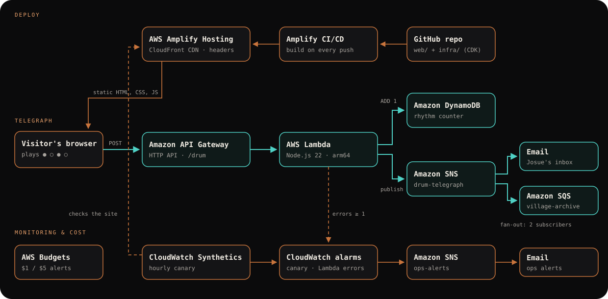

# Josue.cloud — Before SNS, there was the drum

Portfolio of **Tiaya Fotseu Josue** — Cloud & DevOps Engineer · Serverless Developer, Buea, Cameroon — built for the AWS Student Builder Challenge ("Build Your Tech Superpower").

**Live site:** https://main.d2edrxdeaouf1j.amplifyapp.com · **Play the drum:** https://main.d2edrxdeaouf1j.amplifyapp.com/#drum · **Stage Mode:** https://main.d2edrxdeaouf1j.amplifyapp.com/?mode=stage · **How it's built:** https://main.d2edrxdeaouf1j.amplifyapp.com/how-it-works/

## The one creative feature: The Talking Drum

A two-tone slit drum, inspired by the talking-drum and slit-drum traditions of Cameroon and West & Central Africa. Play four beats (low ● / high ○) and the drum answers with one of eight messages about me. Each phrase is also published through a real AWS messaging system: API Gateway → Lambda → DynamoDB + SNS, fanned out to email and an SQS queue. Drummer = publisher, rhythm = message, villages = subscribers.

- Mouse, touch and keyboard (focus the drum, press **F** low / **J** high). Pads are real buttons.
- Sound is synthesised with the Web Audio API (no audio files), off until you tap.
- The secret phrase ● ● ○ ● opens Stage Mode.

## Architecture



| AWS service | Purpose | Est. monthly cost |
|---|---|---|
| AWS Amplify Hosting | Git-connected CI/CD; serves the static export through CloudFront with security headers | ~$0 |
| Amazon API Gateway (HTTP API) | `GET /drum` (counter) and `POST /drum` (phrase), throttled 2 rps / burst 10 | ~$0 |
| AWS Lambda (Node.js 22, arm64) | Validates `^[LH]{4}$`, increments the counter, publishes to SNS | ~$0 |
| Amazon DynamoDB (on-demand) | "Rhythms have crossed the cloud" counter | ~$0 |
| Amazon SNS | `drum-telegraph` fan-out (email + SQS); `ops-alerts` for alarms | ~$0 |
| Amazon SQS | `village-archive` subscriber queue | ~$0 |
| Amazon CloudWatch Synthetics | Hourly canary on the live site | ~$0.74 |
| AWS Budgets | $1 / $5 monthly cost alerts | $0 |

Infrastructure is AWS CDK v2 (TypeScript) in [`infra/`](infra/), region us-east-1. The site is a Next.js static export in [`web/`](web/) and works fully even if the API is unreachable.

## Stack

Next.js (App Router, `output: 'export'`) · TypeScript · Tailwind CSS v4 · GSAP + Lenis · Web Audio API · Vitest · Playwright + axe · AWS CDK v2.

## Run locally

```bash
cd web && npm ci && npm run dev          # http://localhost:3000 (set NEXT_PUBLIC_DRUM_API=<API URL, no trailing slash> to enable the telegraph; read at build time)
npm test                                  # unit tests (Vitest)
npm run build && npx playwright install chromium && npm run e2e   # static export + end-to-end tests
cd ../infra && npm ci && npx cdk deploy -c siteUrl=<your Amplify URL>   # backend
```

## Accessibility

Every section is readable without JavaScript (static HTML). The drum is fully playable by keyboard, has accessible names, an `aria-live` announcement for each message and a text list of all messages. `prefers-reduced-motion` turns off smooth scrolling, reveals and pulses; sound still works. Sound never plays before a user gesture and is never needed to understand anything.

## Credits

Fonts: Anton, Inter Tight, JetBrains Mono (Google Fonts, self-hosted at build). Libraries: Next.js, React, Tailwind CSS, GSAP, Lenis, three.js / React Three Fiber. Layout pacing inspired by award-winning portfolios; all text, artwork (emblem, drum illustration, project covers) and photos are original or the owner's own.

## How it was built (coding-agent disclosure)

Planned and built with Claude Code as a coding agent: a written spec and implementation plan, phase-by-phase implementation with tests written first, a separate reviewer pass per phase, and deployment to AWS. Every fact on the site comes from the owner's content file (`plan.md`); the owner reviewed the result.

## Planning documents

Requirements, research, PRD, design spec and implementation plan are in [docs/](docs/) — see [the design spec](docs/superpowers/specs/2026-11-06-talking-drum-portfolio-design.md) and [the implementation plan](docs/superpowers/plans/2026-11-06-talking-drum-portfolio.md).

## License

[MIT](LICENSE) © 2026 Tiaya Fotseu Josue
